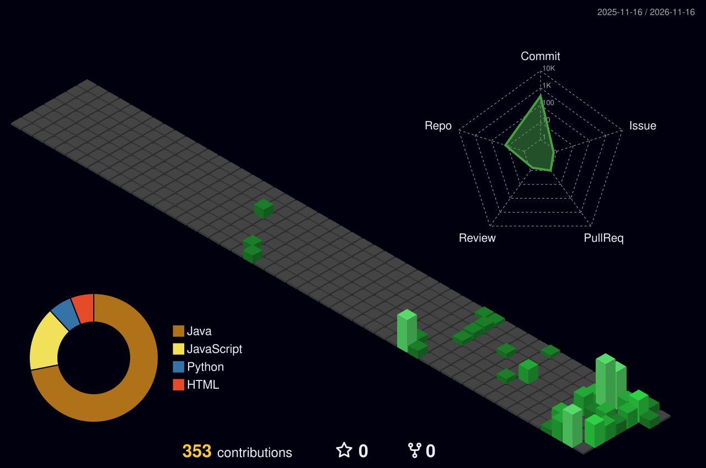

 

  

**Student | Java Backend Development | Problem Solving**

*I enjoy understanding how things work, writing clean code, and improving one solution at a time.*

---

## 🖥️ Developer Dashboard

<table>
<tr>
<td width="34%" valign="top">

### 👨‍💻 Profile

**Prakash Chakali**

- 🎓 Student
- ☕ Java & OOP
- ⚙️ Spring Boot & REST APIs
- 🗄️ SQL & MySQL
- 🧩 DSA with Java
- 🐳 Docker fundamentals

[View GitHub Profile](https://github.com/Chakaliprakash)

</td>
<td width="66%" valign="top">

### ⚡ Live GitHub Metrics

</td>
</tr>
</table>

## 🧭 Explore My Workspace

| 🧠 Problem Solving | ⚙️ Backend Engineering | 🚀 Featured Builds |
|:---:|:---:|:---:|
| [Java DSA Dashboard](https://github.com/Chakaliprakash/Dsa_Java) | [SpringAI](https://github.com/Chakaliprakash/SpringAI) | [MysteryStay](https://github.com/Chakaliprakash/MysteryStay) |
| Topic-wise solutions, patterns and Codeforces | Java, Spring Boot and AI integration | Intelligent hotel inventory platform |
| [Open DSA README](https://github.com/Chakaliprakash/Dsa_Java#readme) | [Open SpringAI](https://github.com/Chakaliprakash/SpringAI) | [Open MysteryStay](https://github.com/Chakaliprakash/MysteryStay) |

## 🛠️ Technology Stack

### Languages

### Backend & Database

### Tools & Platforms

<b>What I am learning and practising</b>

- **Java:** OOP, Collections, Streams, Exception Handling, Multithreading
- **Backend:** Spring Boot, REST API design, validation, authentication and layered architecture
- **Database:** SQL, MySQL, joins, indexes and database design
- **DSA:** Arrays, strings, hashing, two pointers, sliding window, binary search, greedy and dynamic programming
- **Tools:** Git, GitHub, Maven, Docker and Postman

## 🚀 Featured Projects

<table>
<tr>
<td width="50%" valign="top">

### 🏨 [MysteryStay](https://github.com/Chakaliprakash/MysteryStay)

Intelligent masked hotel inventory monolith.

**Stack:** Java · Spring Boot · React · MySQL

</td>
<td width="50%" valign="top">

### 🏦 [Secure Digital Wallet](https://github.com/Chakaliprakash/Secure-Digital-Wallet--Banking-API)

Banking API focused on secure transactions and backend workflows.

**Stack:** Spring Boot · Java · REST APIs

</td>
</tr>
<tr>
<td width="50%" valign="top">

### 🔍 [LogSentry](https://github.com/Chakaliprakash/LogSentry)

Multithreaded log analyzer and search engine.

**Stack:** Core Java · Multithreading

</td>
<td width="50%" valign="top">

### 🗃️ [MiniDB](https://github.com/Chakaliprakash/MiniDB)

Educational in-memory relational database management system.

**Stack:** Java 21

</td>
</tr>
<tr>
<td width="50%" valign="top">

### ✉️ [AI Email Generator](https://github.com/Chakaliprakash/AI-Email-Generator)

AI-assisted email writing application.

**Stack:** JavaScript · AI integration

</td>
<td width="50%" valign="top">

### 🧠 [Java DSA Practice](https://github.com/Chakaliprakash/Dsa_Java)

Topic-wise algorithm practice with a dedicated Codeforces dashboard.

**Stack:** Java 21 · DSA

</td>
</tr>
</table>

## 📊 Coding & Contribution Analytics

### 📅 Contribution Activity

### 🌌 3D Contribution Universe

Generated automatically by GitHub Actions. The 3D calendar refreshes on its scheduled workflow.

## 📂 All Public Repositories

<!-- AUTO-REPOSITORY-MAP:START -->
| Repository | Focus |
|---|---|
| Repository list is refreshed automatically by GitHub Actions. | [Browse all repositories](https://github.com/Chakaliprakash?tab=repositories) |
<!-- AUTO-REPOSITORY-MAP:END -->

The repository directory above is maintained automatically from my public GitHub repositories.

## 🎯 Current Focus

- Strengthening Java and object-oriented programming fundamentals.
- Solving DSA problems by recognizing reusable patterns.
- Building backend applications using Spring Boot and MySQL.
- Learning Docker and practical deployment workflows.
- Writing maintainable code and understanding system design fundamentals.

## 🤝 Let's Connect

  

**Thanks for visiting my profile!**

*Keep learning. Keep building. Keep improving.*

