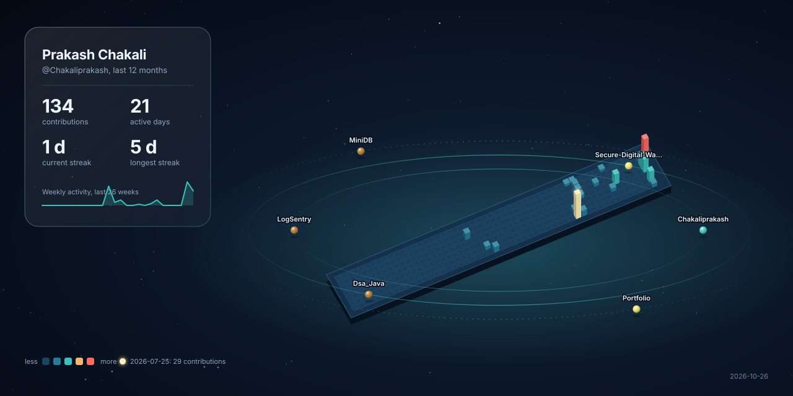

 

---

<table>
<tr>
<td width="58%" valign="top">

## ◈ SYSTEM PROFILE

**NAME**  
Prakash Chakali

**ROLE**  
Java Backend Developer

**LOCATION**  
Hyderabad, India

**FOCUS**  
Spring Boot · REST APIs · SQL

Computer Science graduate focused on building reliable backend applications, secure services, and useful software.

- 🔐 Interested in authentication, API security, and database design
- 🧠 Strengthening DSA and core computer science fundamentals
- 🎯 Seeking entry-level Java Backend / Full Stack opportunities

</td>
<td width="42%" valign="top">

## ◈ CORE MODULES

</td>
</tr>
</table>

## ◈ FEATURED BUILDS

## ◈ LIVE GITHUB TELEMETRY

Stats and language cards are generated by external services from GitHub data. They can be delayed or temporarily unavailable; language distribution is not a measure of skill.

## ◈ CONTRIBUTION ARCHIVE

3D contribution visual generated automatically from GitHub activity. The workflow refreshes it weekly; open Actions to check the latest run.

## ◈ REPOSITORY MAP

| Repository | Focus |
|---|---|
| [AI Email Generator](https://github.com/Chakaliprakash/AI-Email-Generator) | AI-assisted email generation |
| [Leave Management System](https://github.com/Chakaliprakash/Leave-Management-System) | Leave-management application |
| [SpringAI](https://github.com/Chakaliprakash/SpringAI) | Java and Spring AI exploration |
| [Ecommerce](https://github.com/Chakaliprakash/Ecommerce) | E-commerce frontend/backend |
| [Dsa_Java](https://github.com/Chakaliprakash/Dsa_Java) | Java DSA practice |

## ◈ ESTABLISH CONNECTION

Thanks for visiting — feel free to explore the projects.

